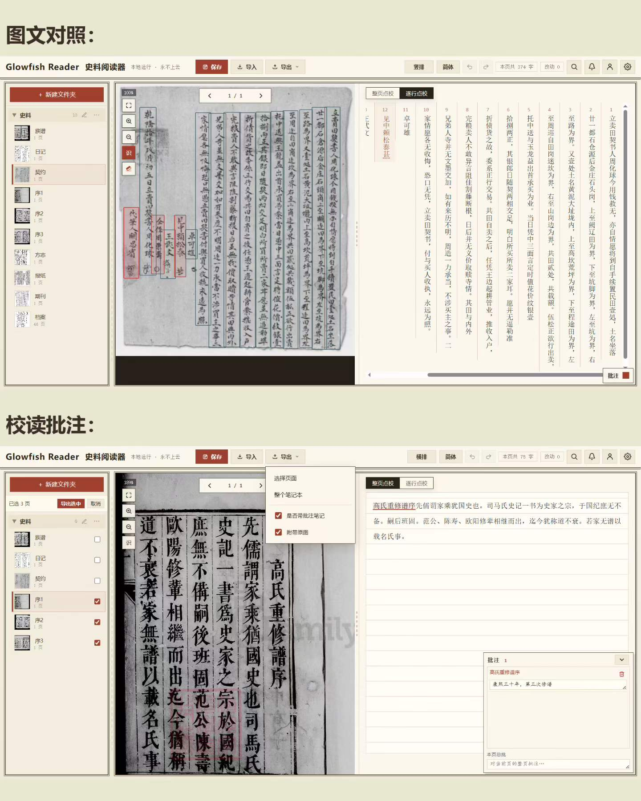
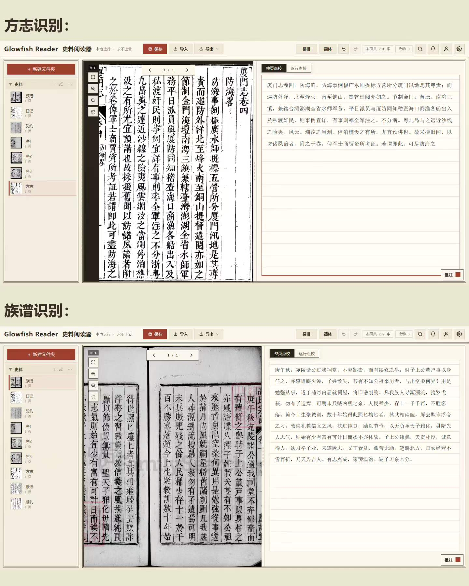
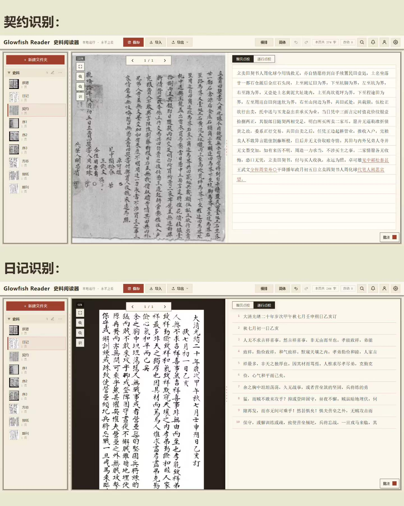
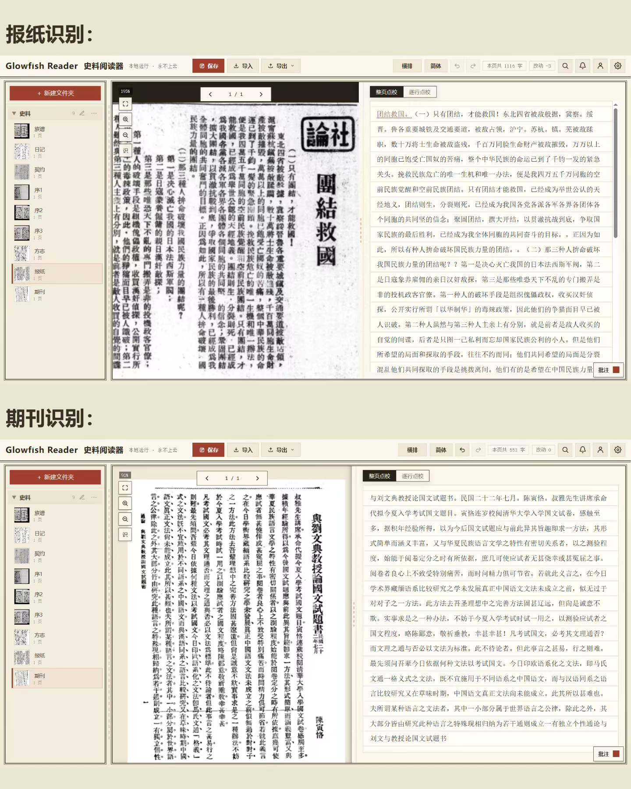
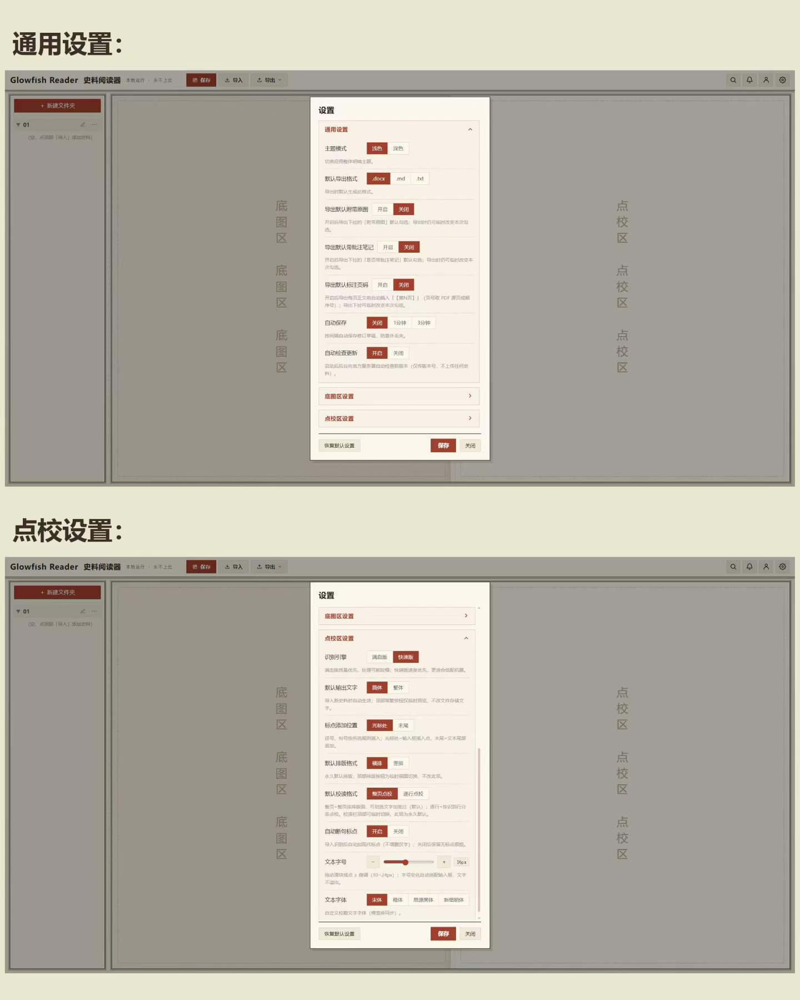

<div align="center">

# 🐟 Glowfish Reader · 史料阅读器

**面向古籍与历史文献的本地 OCR 阅读与点校工作台**

*完全本地运行 · 永不上云 · 无需登录*

[](#环境要求)
[](LICENSE)
[](#环境要求)
[](docs/MODELS.md)
[](#性能与-gpu-加速)



</div>

---

## 这是什么

**Glowfish Reader** 是一款为历史研究者、家谱编修者与古籍爱好者打造的桌面应用，解决一个核心问题：
**把扫描版的古籍、方志、族谱、契约、日记、老报纸，变成可检索、可点校、可导出的数字化文本**。

它不是一个通用的 OCR 工具，而是针对中文历史文献的三大痛点深度定制：

| 传统 OCR 工具的问题 | Glowfish Reader 的解法 |
|---|---|
| 竖排右起、双行夹注版面识别错乱 | **竖排右起栏序还原**：列检测 + 读序重排，正确处理双行夹注 |
| 繁体、异体字、形近字错误率极高 | **多层古文后处理**：形近字纠错 → 本地断句模型 → 语义纠错模型 → 域词典修复 |
| 识别结果无法协作校对与成稿 | **点校工作台**：整页/逐行点校、批注、简繁切换，一键导出 Word |

> 🔒 **隐私优先**：所有图片、文本、批注仅存本机磁盘；OCR 与全部模型本地推理，无任何云端调用、无账号系统。

## 功能一览

### 📚 多体裁史料识别

针对不同体裁做了大量版面与后处理规则优化，开箱即用：

| 图文对照 | 方志 / 族谱 |
|:---:|:---:|
|  |  |
| **契约 / 日记** | **报纸 / 期刊** |
|  |  |

支持的典型史料：**古籍影印本、地方志、族谱家谱、契约文书、日记手稿、民国报刊、期刊论文**等繁体/简体竖排与横排文献。

### ✍️ 专业点校工作台

- **整页点校 / 逐行点校**双模式，图文对照逐行核对
- **批注系统**：页面级与行级批注，支持批注导出
- **简繁一键切换**、原文/点校双栏对照
- **双行夹注**正确嵌入正文流
- 识别存疑处自动标红提示，点击即可修正

### ⚙️ 灵活配置



主题外观、默认显示模式、各体裁专属识别开关、自动保存间隔、点校字号与字体、自动勤务记录等，均可按习惯调整。

### 🚀 更多特性

- **断点续识**：大型古籍逐页 checkpoint，重启不丢进度，失败自动接续
- **GPU 加速**：一键启用 NVIDIA CUDA（ONNX Runtime GPU），大幅缩短整页识别耗时
- **项目化管理**：史料以文件夹组织，识别状态、进度一目了然
- **Word 导出**：点校成果一键导出 `.docx`，直接进入出版/引用流程

## 快速开始

### 方式一：从源码运行（推荐开发者）

```powershell
# 1. 克隆仓库
git clone https://github.com/GlowFisher/Glowfish_Reader.git
cd Glowfish_Reader

# 2. 一键引导：创建虚拟环境、安装依赖、构建前端、自动检测并下载模型、校验工作区
powershell -NoProfile -ExecutionPolicy Bypass -File .\bootstrap.ps1

# 3. 校验环境完整性
powershell -NoProfile -ExecutionPolicy Bypass -File .\verify.ps1 -Full
```

> 💡 `bootstrap.ps1` 会自动完成**模型检测 → 下载 → SHA256 校验**：PP-OCRv6 检测/识别模型直接从官方镜像下载；断句（punct）与语义纠错（mlm）模型需按 [docs/MODELS.md](docs/MODELS.md) 本地导出一次。

### 方式二：构建安装器

```powershell
$env:GLOWFISH_OCR_MODELS = "D:\path\to\verified\models"
powershell -NoProfile -ExecutionPolicy Bypass -File .\build-release.ps1 -Notes "..."
```

### 环境要求

| 组件 | 要求 |
|---|---|
| 操作系统 | Windows 10/11 x64 |
| Python | 3.12（服务端）+ 3.10（OCR 识别子进程，conda 环境） |
| Node.js | 22 LTS（仅构建前端时需要） |
| Inno Setup 6 | 仅构建安装器时需要 |
| GPU（可选） | NVIDIA CUDA 显卡，用于加速识别 |

## 性能与 GPU 加速

在 **设置 → GPU 加速** 中一键启用 CUDA 推理：

- 无需任何额外配置，自动检测可用显卡
- 启用后整页识别速度显著提升（实测 RTX 3060 Laptop 上提升数倍）
- 未启用时自动回退 CPU 模式，功能完全一致

## 工作原理

```
扫描图片 ──► PP-OCRv6 检测 (det) ──► 竖排栏序还原 ──► PP-OCRv6 识别 (rec)
                                                            │
                        ┌───────────────────────────────────┘
                        ▼
        形近字纠错 ──► 古文断句模型 (punct) ──► 语义纠错模型 (mlm)
                        │                              │
                        ▼                              ▼
                  域词典 / 混淆词典 / 词锚 / 姓氏表 后处理
                        │
                        ▼
              点校工作台 ──► 批注 / 校对 ──► 导出 Word
```

全部推理基于 **ONNX Runtime**（可选 CUDA EP），模型清单与哈希由 [`ocr/models.lock.json`](ocr/models.lock.json) 锁定，详见 **[docs/MODELS.md](docs/MODELS.md)**。

## 项目结构

本仓库为**单一 monorepo**，所有组件同仓管理、统一版本：

| 目录 | 职责 |
|---|---|
| `host/` | Windows 桌面集成与打包（pywebview 壳 + 内嵌 FastAPI + 点校/文档/导出服务） |
| `ui/` | 阅读器前端（原生 HTML/CSS/JS，构建产物 `dist/` 被 host 消费） |
| `ocr/` | OCR 引擎与公共 API（`glowfish_ocr` 包，纯本地独立） |
| `contracts/` | 跨组件共享契约（JSON Schema / OpenAPI） |
| `scripts/` | 工作区校验、模型检测/下载/校验等引导脚本 |
| `docs/` | 模型清单、宣传截图等文档 |

## 外部模型资源

OCR 模型**有意排除在 Git 之外**（总体积约 350 MB），克隆后由引导脚本自动获取：

- 模型统一存放于 `host/glowfish_reader/proofread/models/`（可用 `GLOWFISH_OCR_MODELS` 覆盖）
- `ocr/models.lock.json` 定义每个文件的路径、大小、SHA256 与下载/构建来源
- 来源均为开源模型：[PaddlePaddle PP-OCRv6](https://github.com/PaddlePaddle/PaddleOCR)、[ethanyt/guwenbert-base](https://huggingface.co/ethanyt/guwenbert-base)、[raynardj/classical-chinese-punctuation-guwen-biaodian](https://huggingface.co/raynardj/classical-chinese-punctuation-guwen-biaodian)

配置说明见 [`.env.example`](.env.example)。

## 路线图

- [ ] Linux / macOS 支持
- [ ] 更多史体裁切的版面规则
- [ ] 批注协同导出格式扩展

> 欢迎通过 Issue 提出需求与史料体裁适配建议。

## 贡献

欢迎贡献！请遵循：

- 请勿提交模型、安装器、数据库、凭据、用户文件、构建产物或本地环境
- 使用功能分支 + Pull Request 流程
- 详见 [CONTRIBUTING.md](CONTRIBUTING.md) 与 [CODE_OF_CONDUCT.md](CODE_OF_CONDUCT.md)

## 许可证

本项目以 [**GNU AGPL-3.0**](LICENSE) 协议开源发布。

<div align="center">

**如果这个项目对你有帮助，欢迎点一个 ⭐ Star**

</div>
